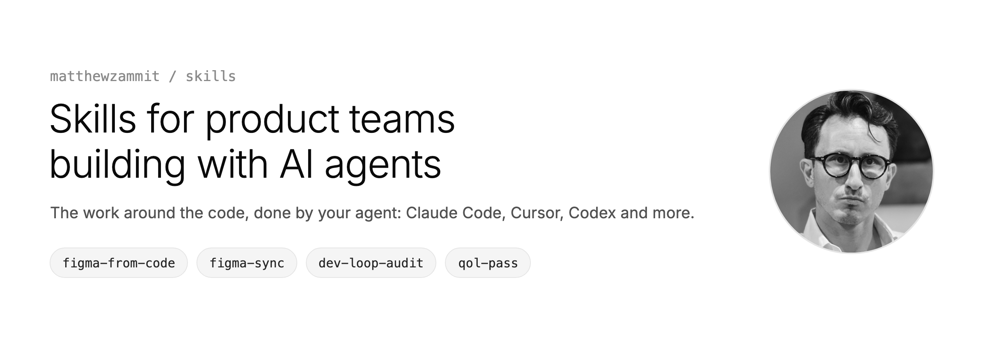
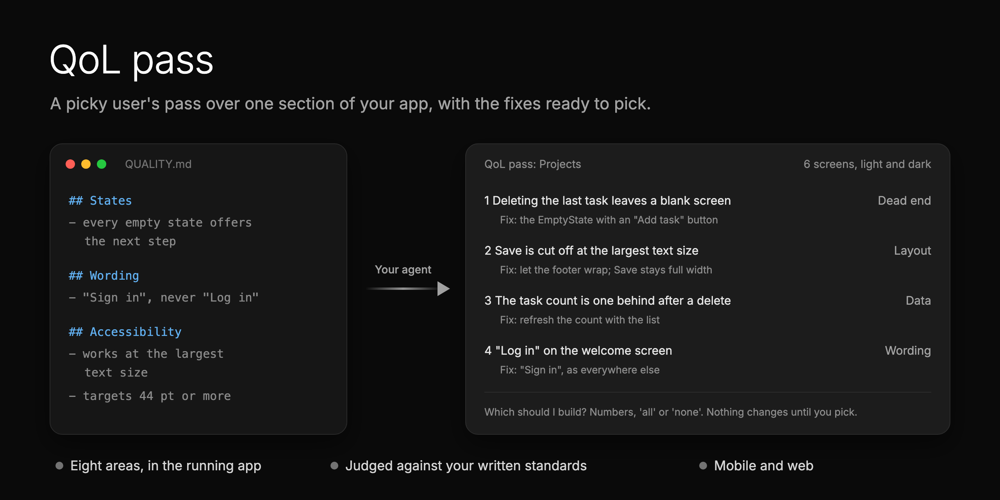

<picture>
  <source media="(prefers-color-scheme: dark)" srcset="assets/banner-dark.png">
  
</picture>

# Skills for product teams building with AI agents

[](https://skills.sh/matthewzammit/skills)

Agent skills for the jobs around the code that never make it to the top of the list: keeping Figma in line with
what you actually shipped, catching the small stuff users feel, and working out where the week went. Each one came out of shipping a real app with AI
agents, so the mistakes are already made for you.

Each skill is a folder: a `SKILL.md` your agent follows step by step, and a `README.md` for you. They ask before they
change anything, check their own work, and tell you what they measured and what they guessed. They work in Claude
Code, Cursor, Codex and [other agents](https://skills.sh).

## Skills

**Design**

| Skill | What it does | When you run it |
|---|---|---|
| [figma-from-code](skills/figma-from-code/) | Rebuilds your mobile or web app in Figma from its code: every screen and state in light and dark, responsive web views, a real design system. | Once, for the first build |
| [figma-sync](skills/figma-sync/) | Keeps that Figma file in step with the code: finds what changed, asks, redraws, records the sync. Works on any Figma file that mirrors your app. | After a change, each release, weekly |

**Product**

| Skill | What it does | When you run it |
|---|---|---|
| [qol-pass](skills/qol-pass/) | Walks one section of your running app like a picky user: dead ends, stale data, wording, empty and error states, layout at the largest text size, accessibility. Judges it against your QUALITY.md (and writes one if you have none). | Any time, one section per pass |

**Engineering**

| Skill | What it does | When you run it |
|---|---|---|
| [dev-loop-audit](skills/dev-loop-audit/) | Audits CI, your local checks and your agent's time together: where the week went, ranked by minutes, with a trend and the fixes to build. | Any time, or weekly |

More are on the way. Watch the repo to hear when they land.

## Install (30 seconds)

**Any agent** (Claude Code, Cursor, Codex and more):

```bash
npx skills add matthewzammit/skills
```

It asks which skills and which agents you want. Add `-g` to install them for every project.

**Updates:** run the same command again.

**Or as a Claude Code plugin:**

```
/plugin marketplace add matthewzammit/skills
/plugin install matthewzammit-skills@matthewzammit
```

**Updates:** run `/plugin marketplace update matthewzammit`, or turn on auto-update for this marketplace in `/plugin`,
under Marketplaces.

Pick one way per agent, or you get every skill twice. That's it: each skill asks for what it needs the first time you
run it.

## Why these skills exist

### #1: Figma falls behind the code

<p align="center">
  
</p>

**The problem.** When AI builds the product with you, nobody draws every screen in Figma first. You grow the product
in code, screen by screen. A few weeks in, Figma no longer shows what you shipped, and nobody has time to redraw it.
But Figma is still where your team reviews, keeps a reference, and makes marketing assets.

**The fix.** [**figma-from-code**](skills/figma-from-code/) rebuilds your mobile or web app in Figma from its real code:
every screen and state in light and dark, responsive views for the web, on a design system of real components and
variables. [**figma-sync**](skills/figma-sync/) then keeps it up to date after each change, with a weekly drift check
that asks before it redraws anything.

> On the [Binderr](https://binderr.com) Wallet app, Claude rebuilt about **716 screens**, **144 components** and a
> **28-slide brand deck** in two days, much of it overnight.

[Read more about Figma from code](skills/figma-from-code/)

<br>

### #2: Nobody knows where the week went

<p align="center">
  
</p>

**The problem.** A slow week rarely has one cause. Some of it is CI: a flaky test, a slow job, code that landed on
main without a passing run. Some of it is local: hooks that are not installed, or a check before each push that runs
every test twice. And when agents write and test the code, some of it is the agent: waiting, retrying, or running
the same simulator check again and again. Most audits look at one of these at most.

**The fix.** [**dev-loop-audit**](skills/dev-loop-audit/) checks all three:

- **CI:** your GitHub Actions runs. Failures, flaky tests, slow jobs, billed minutes, and code on main with no
  passing run.
- **Local checks:** your git hooks and the tests that run before a push. Installed? The same checks as CI? How long
  does a push take?
- **Agent time:** waits, retries, blocked commands, and checks in a simulator or browser, from your agent's own
  transcripts (Claude Code only for now).

It ranks every problem by minutes lost, double-checks the biggest ones, keeps a trend week to week, and asks which
fixes to build. Run it any time, or every Monday.

[Read more about the dev loop audit](skills/dev-loop-audit/)

<br>

### #3: The small stuff ships broken

<p align="center">
  
</p>

**The problem.** Code review catches bugs. It rarely catches what people actually feel: a blank screen after you
delete the last item, a button that just says "OK", a count that is one behind, a label cut off at the largest
text size. And most teams have no written quality bar, so every review is one person's taste.

**The fix.** [**qol-pass**](skills/qol-pass/) walks one section of your running app (a simulator or a browser) and
checks eight areas: behaviour, dead ends, wrong or stale data, wording, empty, loading and error states, layout
edge cases, motion, and accessibility. It judges what it finds against your own standards, or drafts a
`QUALITY.md` from what your code already does when you have none. You get one numbered list with a fix for each,
and it builds only what you pick, with before and after shots.

[Read more about the QoL pass](skills/qol-pass/)

## Contributing

Run reports and pull requests are welcome, above all from web apps. See [CONTRIBUTING.md](CONTRIBUTING.md).

## License

[MIT](LICENSE). Made by [Matthew Zammit](https://github.com/matthewzammit). If a skill helps, open an issue and say
what worked.
