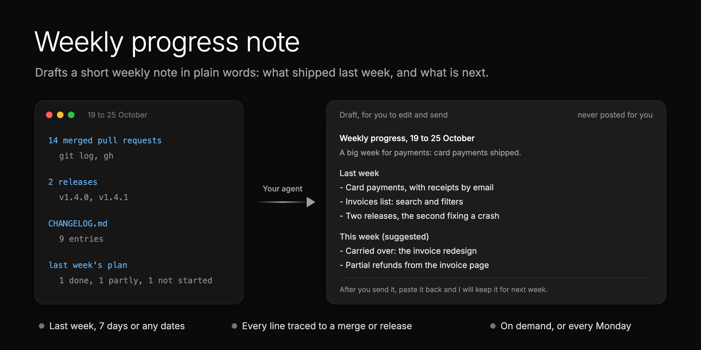
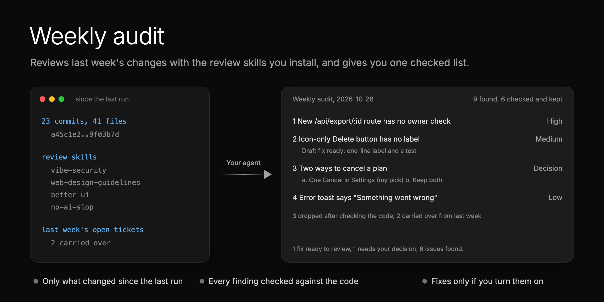

<picture>
  <source media="(prefers-color-scheme: dark)" srcset="assets/banner-dark-v2.png">
  
</picture>

# Skills for product teams building with AI agents

[](https://skills.sh/matthewzammit/skills)

Ready-made workflows for design, quality, code review and team updates. Each one comes from shipping a real app with
AI agents.

Each skill is a folder: a `SKILL.md` your agent follows, and a `README.md` for you. They ask before they change
anything and check their own work. They work in Claude Code, Cursor, Codex and [other agents](https://skills.sh).

## Skills

**Design**

<table>
<tr><th width="200" align="left">Skill</th><th align="left">What it does</th><th width="200" align="left">When you run it</th></tr>
<tr><td><a href="skills/figma-from-code/">figma-from-code</a></td><td>Builds your Figma from your codebase: every screen and state, in light and dark, on a real design system.</td><td>Once, to start</td></tr>
<tr><td><a href="skills/figma-sync/">figma-sync</a></td><td>Keeps your Figma updated as the code changes. Works with any Figma file that mirrors your app.</td><td>After a change or a release, or weekly</td></tr>
</table>

**Product**

<table>
<tr><th width="200" align="left">Skill</th><th align="left">What it does</th><th width="200" align="left">When you run it</th></tr>
<tr><td><a href="skills/qol-pass/">qol-pass</a></td><td>Checks your app against a quality standard, one section at a time: dead ends, wrong data, wording, empty and error states, text size, accessibility. Writes the standard if you have none.</td><td>Any time, one section at a time</td></tr>
<tr><td><a href="skills/weekly-progress-note/">weekly-progress-note</a></td><td>Prepares a summary of what was built and what is next, in plain words. Ready for your PM update.</td><td>Every Monday, or any time</td></tr>
</table>

**Engineering**

<table>
<tr><th width="200" align="left">Skill</th><th align="left">What it does</th><th width="200" align="left">When you run it</th></tr>
<tr><td><a href="skills/dev-loop-audit/">dev-loop-audit</a></td><td>Finds what slows down your CI, git hooks and agents, ranked by minutes lost, with the fixes.</td><td>Every Monday, or any time</td></tr>
<tr><td><a href="skills/session-retro/">session-retro</a></td><td>Finds what went wrong in an agent session, including failures a quick read misses, and fixes them with checks, hooks and scripts. Keeps a record, so a problem that comes back is fixed at its cause.</td><td>After a long session</td></tr>
<tr><td><a href="skills/weekly-audit/">weekly-audit</a></td><td>Reviews every change of the week for security, accessibility, design and code quality, with the review skills you install. Every finding is checked against the code.</td><td>Every Monday, or any time</td></tr>
</table>

More are on the way. Watch the repo to hear when they land.

## Install (30 seconds)

**Any agent** (Claude Code, Cursor, Codex and more):

```bash
npx skills add matthewzammit/skills
```

It asks which skills you want, which agents, and where: this project only, or global (every project on your
computer).

**Updates:** run the same command again.

**Or as a Claude Code plugin:**

```
/plugin marketplace add matthewzammit/skills
/plugin install matthewzammit-skills@matthewzammit
```

**Updates:** run `/plugin marketplace update matthewzammit`, or turn on auto-update for this marketplace in `/plugin`,
under Marketplaces.

Pick one way per agent, or you get every skill twice. That's it: each skill asks for what it needs the first time you
run it.

## What they do for you

### Design

#### #1: Build your Figma from your codebase

<p align="center">
  
</p>

[**figma-from-code**](skills/figma-from-code/) builds your app in Figma from its code: every screen and state, in light
and dark, with responsive web views, on a design system of real components. [**figma-sync**](skills/figma-sync/) keeps
it updated after each change, and checks it every week.

When AI builds the product with you, nobody draws every screen in Figma first. But Figma is still where your team
reviews, finds a screen, and makes marketing assets.

> On the [Binderr](https://binderr.com) Wallet app, Claude rebuilt about **716 screens**, **144 components** and a
> **28-slide brand deck** in two days, much of it overnight.

[Read more about Figma from code](skills/figma-from-code/)

<br>

### Product

#### #2: Keep your product to a quality standard

<p align="center">
  
</p>

[**qol-pass**](skills/qol-pass/), a Quality of Life (QoL) pass, checks one section of your running app against your
quality standard: behaviour, dead ends, wrong data, wording, empty and error states, layout at the largest text
size, motion and accessibility. No written standard yet? It writes a `QUALITY.md` from what your code already does.
You get a list of fixes, and it builds the ones you pick, with before and after screenshots.

Code review catches bugs, not a blank screen, a vague button or a cut-off label. A written standard holds every
section to the same bar, not one person's taste.

[Read more about the Quality of Life pass](skills/qol-pass/)

<br>

#### #3: Prepare a summary of what was built

<p align="center">
  
</p>

[**weekly-progress-note**](skills/weekly-progress-note/) prepares a short summary of what was built and what is next,
in plain words: perfect for a PM, founder or client update. Every line comes from something merged or released. Use
it for last week, the last 7 days or any dates. It never posts: you edit it and send it.

The changelog lists every change, but nobody reads it. This is the short version, ready in a minute.

[Read more about the weekly progress note](skills/weekly-progress-note/)

<br>

### Engineering

#### #4: Find what slows down your CI and agents

<p align="center">
  
</p>

[**dev-loop-audit**](skills/dev-loop-audit/) finds what slowed your team down, ranked by minutes lost:

- **CI:** failed and flaky runs, slow jobs, billed minutes, and code on main with no passing run.
- **Git hooks:** missing hooks, checks that differ from CI, and slow pushes.
- **Agents:** waits, retries, blocked commands, and slow simulator or browser checks (Claude Code only for now).

It double-checks the biggest problems, keeps a trend week to week, and builds the fixes you pick. Most audits look
only at CI.

Thanks to [Simon Agius Muscat](https://github.com/simonamdev), who suggested this audit and helped with tips and
details.

[Read more about the dev loop audit](skills/dev-loop-audit/)

<br>

#### #5: Review every change for security, accessibility and quality

<p align="center">
  
</p>

[**weekly-audit**](skills/weekly-audit/) reviews every change since the last run for security, accessibility, design
and code quality, with the review skills you install. It checks each finding against the code, drops the false
ones, and keeps a record every week. Choices come with options and a pick, and open findings carry over to next
week. Turn on fixes, and it opens a draft pull request for each simple one.

When agents write much of the code, a week brings more changes than anyone can read closely. This gives every one of
them a proper review. It also tells you which review skills to install for your stack.

[Read more about the weekly audit](skills/weekly-audit/)

## Contributing

Run reports and pull requests are welcome, above all from web apps. See [CONTRIBUTING.md](CONTRIBUTING.md).

## License

[MIT](LICENSE). Made by [Matthew Zammit](https://github.com/matthewzammit). If a skill helps, open an issue and say
what worked.
