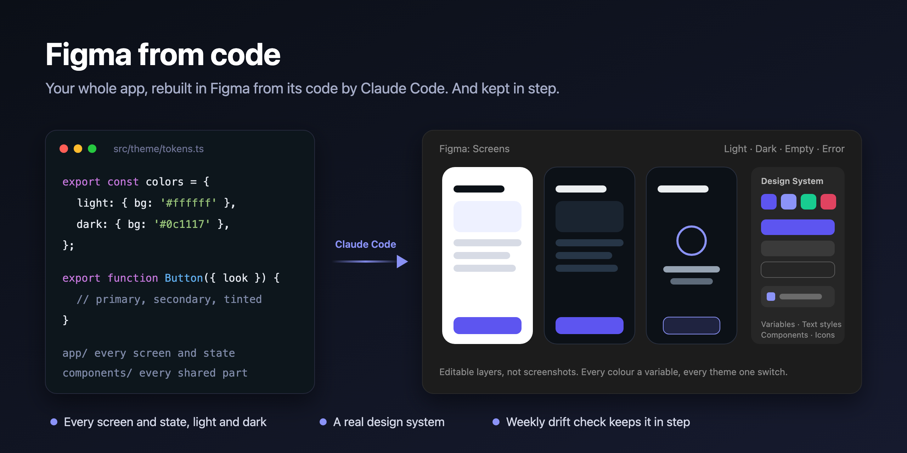
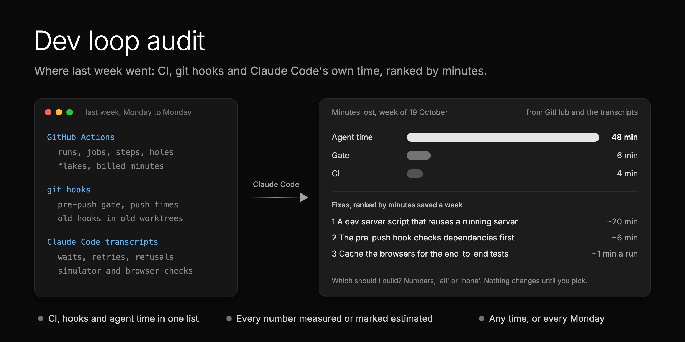

# Skills for product teams who build with Claude Code

[](https://skills.sh/matthewzammit/skills)

My agent skills for the work around the code that nobody has time for: keeping the design in step with the
product, and finding out where the week went. They come from shipping a real app with Claude Code, with the mistakes
already made for you.

Each skill is a folder: a `SKILL.md` the agent follows step by step, and a `README.md` for you. They ask before they
act, check their own work, and say what they measured and what they guessed. Built and tested with Claude Code; they
install into Cursor, Codex and [other agents](https://skills.sh) too.

## Install (30 seconds)

<details>
<summary><strong>Claude Code</strong>, as a plugin</summary>

```
/plugin marketplace add matthewzammit/skills
/plugin install matthewzammit-skills@matthewzammit
```

To update: `/plugin marketplace update matthewzammit`.

</details>

<details>
<summary><strong>Any agent</strong> (Claude Code, Cursor, Codex and more), as editable files</summary>

```bash
npx skills add matthewzammit/skills
```

It asks which skills and agents to install. Add `-g` to install for every project. To update, run it again.

</details>

Pick one per agent: both together give you every skill twice. There is nothing else to set up: each skill asks what
it needs the first time you run it.

## Why these skills exist

### #1: Figma falls behind the code

<p align="center">
  
</p>

**The problem.** When AI builds the product with you, nobody draws every screen in Figma first. You grow the product
in code, screen by screen. Within weeks Figma no longer shows what you shipped, and nobody has the time to redraw it.
But Figma is still where your team reviews, keeps a reference, and makes marketing assets.

**The fix.** [**figma-from-code**](skills/figma-from-code/) rebuilds your mobile or web app in Figma from its real code:
every screen and state in light and dark, responsive views for the web, on a design system of real components and
variables. [**figma-sync**](skills/figma-sync/) then keeps it updated after each change, with a weekly drift check
that asks before it redraws anything.

> On the [Binderr](https://binderr.com) Wallet app, Claude rebuilt about **716 screens**, **144 components** and a
> **28-slide brand deck** in two days, much of it overnight.

[Read more about Figma from code](skills/figma-from-code/)

### #2: Nobody knows where the week went

<p align="center">
  
</p>

**The problem.** Most CI audits read your workflow files and your last few runs. When agents write and test the
code, most of the lost time is outside CI: waits, retries, refused commands, slow checks on a simulator or in a
browser, a hook that runs the same tests twice. Nobody measures it.

**The fix.** [**dev-loop-audit**](skills/dev-loop-audit/) reads GitHub Actions, your git hooks and Claude Code's own
transcripts, ranks every problem by minutes lost, checks the top ones again, keeps a trend, and asks which fixes to
build. Run it any time, or every Monday.

> On the Binderr Wallet app, one week: CI cost 0 people-minutes and 60 runner-minutes. Claude's own checks on the
> simulator cost 190 minutes. The biggest problem was not in CI at all: another agent session cleared a shared build
> cache during a release, and the release took 44 minutes instead of 24. Nobody had measured any of it.

[Read more about the dev loop audit](skills/dev-loop-audit/)

## Reference

**Design**

| Skill | What it does | When you run it |
|---|---|---|
| [figma-from-code](skills/figma-from-code/) | Rebuilds your mobile or web app in Figma from its code: every screen and state in light and dark, responsive web views, a real design system. | Once, for the first build |
| [figma-sync](skills/figma-sync/) | Keeps that Figma file in step with the code: finds what changed, asks, redraws, records the sync. Works on any Figma file that mirrors your app. | After a change, each release, weekly |

**Engineering**

| Skill | What it does | When you run it |
|---|---|---|
| [dev-loop-audit](skills/dev-loop-audit/) | Audits CI, git hooks and AI agent time together: where the loop lost time, ranked by minutes, with a trend and the fixes to build. | Any time, or weekly |

More skills are coming. Watch the repo to hear about them.

## Contributing

Run reports and pull requests are welcome, above all from web apps. See [CONTRIBUTING.md](CONTRIBUTING.md).

## License

[MIT](LICENSE). Made by [Matthew Zammit](https://github.com/matthewzammit). If a skill helps, tell me what worked.
