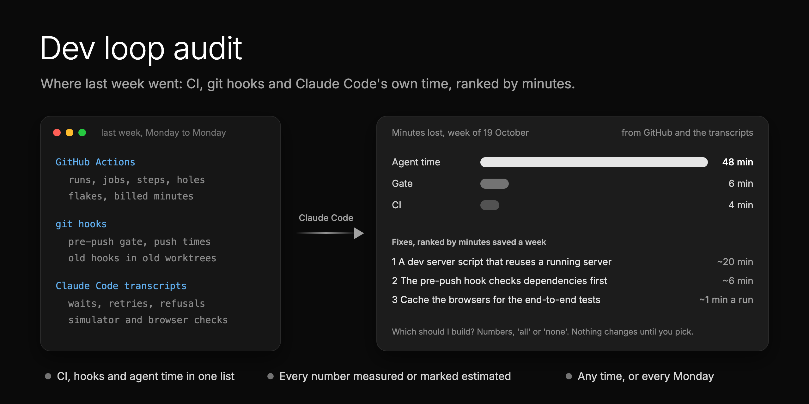

<p align="center">
  
</p>

# Dev loop audit

**Find what slows down your CI, git hooks and agents.** Run it any time, or every Monday. It ranks every problem by
minutes lost, double-checks the biggest ones, keeps a trend, and builds the fixes you pick.

It checks three areas:

1. **CI (GitHub Actions).** Failed and flaky runs, slow jobs, billed minutes, and code on main with no passing run.
2. **Git hooks.** Missing hooks, checks that differ from CI, slow pushes, and pushes that failed for no good reason.
3. **Agents.** Waits, retries, blocked commands, commands typed by hand again and again, and slow simulator or
   browser checks. This part reads Claude Code's transcripts, so it is Claude Code only for now. Other agents get
   areas 1 and 2.

4. **Proof of agent work.** Whether anyone can see that an agent's change was checked: commits stamped with how they
   were verified, checks re-run until green, sleeps added to tests, fix loops, a verify step, and rules a change
   could edit to pass its own review.

Most audits look only at CI. Time lost in one area often shows up in another, so this ranks them all on one list.

## Install

```bash
npx skills add matthewzammit/skills --skill dev-loop-audit
```

It works in Claude Code, Cursor, Codex and other agents. It asks where to install: this project only, or global
(every project on your computer). Run it again to update.

Or as a Claude Code plugin, which installs all the skills in this repo:

```
/plugin marketplace add matthewzammit/skills
/plugin install matthewzammit-skills@matthewzammit
```

## Run it

| You type | When | What happens |
|---|---|---|
| `/dev-loop-audit setup` | Once per repo | Looks at your CI, hooks and transcripts, asks where records go, how you file tickets, and whether to schedule it. |
| `/dev-loop-audit` | Any time, or weekly | Audits last week (Monday to Monday). Or `/dev-loop-audit last 7 days`, or two dates. |

When installed as a Claude Code plugin, the command is `/matthewzammit-skills:dev-loop-audit`. It also starts when you ask
"why is CI so slow?" or "audit our pipeline".

It is **read-only until you pick**: it writes only its report and a row in `trend.csv`. When you pick fixes, it
builds them on a branch and opens a pull request. It never merges.

## What you get

A short reply, and a full report in your records folder. Made-up numbers:

```
Minutes lost, week of 2026-10-19
  CI          4 people-min (1 flaky test, re-run twice); 0 holes; 212 billed runner-min (was 260)
  Gate        6 min waste: 3 pushes failed on stale node_modules; 2 real catches
  Agent time  48 min: 31 sleep-only calls (12 min), 9 retries of `npm test` after a cut-off error (14 min),
              a dev server started 22 times in one session (22 min)

Fixes, ranked by minutes saved a week
  1. Reliability, agent time: a `dev:up` script that reuses a running server (~20 min). Pick.
  2. Reliability, gate: the pre-push hook checks node_modules first and says "run npm ci" (~6 min).
  3. Speed, CI: cache Playwright browsers; the install step is 61 s of a 140 s run (~1 min a run, 40 runs).
Which should I build? Numbers, 'all' or 'none'.
```

## What it found on a real app

We built this audit on our own app: a React Native app, one GitHub Actions job on `main`, a pre-push hook, and
Claude Code doing most of the work. These are real numbers from three weekly runs, not a demo.

| What the audit found | Fix | Before | After |
|---|---|---|---|
| Jest did not exit on CI, so runs hung until the timeout | find what kept Jest open | 461 to 604 s a run | ~215 s |
| One 3,300-line test file was the whole test run | split it into six files on a shared helper | 32 s (that file: 30 s) | 12 s |
| Every push ran every test | run only the tests the change reaches; `main` runs all | 36 s test step | 10 to 11 s |
| The pre-push hook ran lint, typecheck and tests one after another | run them side by side | 57 s cold push | 27 s |
| Jest used 1 worker on the 2-core CI runner (`maxWorkers: '50%'` set for the laptop) | 3 workers on CI only | 136 to 140 s test step | 70 to 85 s |
| A slow test passed on a fast Mac and timed out on the 2-vCPU runner | fix the slow test case | `main` red 14 h, 69 billed min wasted | green |
| A stale ESLint cache let a lint error pass the hook and reach `main` | cold lint cache in the hook | a hole | caught locally |
| The agent sent its tap, screenshot and the screenshot read in separate messages | one message per step | 23.7 s per tap | 12.7 s |
| An agent tool call that blocked for minutes, 19 times in a week | ask in the background, read the answer later | 74.8 min lost | fix in progress |
| A lookup script fetched the whole ticket list once per search term | one fetch, then search | 13.4 min in 24 calls | fix in progress |
| Agent hooks refused correct commands | a helper or a narrower rule for each refused command | 28 refusals a week | 14 |

It also says what is **not** worth it. Turning coverage off on CI: no gain. TypeScript 7
against a warm `tsc --incremental`: 1 s against 1.4 s. A faster git hook manager: hk, Lefthook, prek and
pre-commit took 1.4 to 3 s on 60 staged files
([Pontus's timing](https://x.com/pontusab/status/2122466524493730107)), while the checks inside the hook took 10 to
30 s. Fix the checks, not the hook manager.

## Every check

56 checks in four areas, and 18 more in the mobile and web add-ons. Each finding gives its minutes lost a week,
says **measured** or **estimated**, and names its proof (a run id, a file line, a session). Time someone waited
ranks above runner minutes, which only cost money. Each proposed fix says what it does to both: billed minutes
and how long someone waits. The full rules are in [references/](references/).

### CI (GitHub Actions)

Reliability: can broken code reach `main`?

- **No CI at all**: no workflow that checks code ran on the main branch, or a workflow file that was committed but
  never pushed. Every push is unchecked, so this outranks everything.
- **Holes**: a push to `main` that changed files CI watches and never got a passing run. It is not a hole when a
  later green run checked a commit that contains it; the audit says how long the code waited.
- **Skipped by the workflow's own condition**: a job's `if:` that skips real code, not only release stamps.
- **Failures**: each one sorted into a real catch (working as intended), a flaky test, an environment problem or a
  broken workflow. Only the last three are waste.
- **Flakes**: a run that went green on a re-run, or a commit that failed and later passed with no change.
- **Cancelled runs**: fine when a newer push replaced them; their billed minutes are still waste.
- **Failures that cannot block**: `continue-on-error: true`, `|| true`, `set +e`, or a summary job with
  `if: always()` that passes when the jobs it summarises fail.
- **No `timeout-minutes`**: a hung job runs for 6 hours. The audit suggests twice the job's longest run.
- **Stuck runs**: queued or running more than 6 hours, usually a runner that never came.
- **Billing**: month-to-date use against the plan's free minutes, and runs blocked by billing.

Speed: how long does a run take, and what does it cost?

- **The longest job chain**: the jobs a run waits on one after another. A faster job beside the chain saves money,
  not time.
- **Run time from successful runs only**: median and p90, per job and per step, against last week. A failed run is
  short or hung, so it hides the real time. When a fix landed mid-week, the audit splits the runs before and after it.
- **Queue wait**: over a minute means too few runners.
- **Billed minutes**: each job rounds up to a whole minute (times 2 on Windows, 10 on macOS). A job at 61 s bills
  2 minutes; the audit counts the runs just over a boundary.
- **Path filters**: a filter that still runs on 80% of pushes filters almost nothing.
- **Cache**: a warm run as slow as a cold one means a missed cache. On pull requests GitHub reads only the branch's
  caches and the default branch's, so a cache never saved on `main` leaves every PR cold. On our app a cold run
  took 408 s and a warm one 262 s.
- **Setup against checks**: checkout, toolchain, cache and install time. Over a third of a warm job is worth a look;
  ours spent 32 s of 155 s restoring caches.
- **Workers against cores**: Jest's `maxWorkers: '50%'` is one worker on a 2-vCPU runner, so the test files run one
  after another. On our runner, timed twice each: 1 worker 136 to 140 s, 2 workers 82 to 106 s, 3 workers 70 to
  85 s. More workers than cores won, because each worker waits part of the time. Coverage off saved nothing, and V8
  coverage took 758 s. Free: same job, shorter. Time it on your own runner before you change it.
- **One test file holds the test step**: the slowest file against the whole step. Jest and Vitest print the time of
  slow files in the log. Split that file before you shard or pay for a bigger runner.
- **More jobs, or one?**: parallel jobs cut wall time but repeat setup and round each job up to a minute. Worth it
  when people wait on CI; when CI runs after the merge, one job is cheaper. When you shard, fill shards by each
  file's recorded time, not by file count.
- **Tests scoped to the change on pull requests**: a pull request can run only the tests it reaches when the merge
  queue or `main` runs everything (the rules are under the gate's "Every test on every push").

- **Skip a job before it starts**: a job that checks out and installs, then decides to skip, has already paid for
  the runner. The decision moves to the job's `if:`, or to a small decide job that feeds the others.
- **Setup that repeats or fetches too much**: `fetch-depth: 0` where a blobless checkout (`filter: blob:none`)
  would do, caches saved by untrusted runs, too many shards each paying setup again, and small jobs restoring what
  the whole suite needs. OpenClaw packed 95 planned shards into 63, then rebalanced one group so its slowest job
  went from 403 s to 300 s.
- **Automated review on every push**: an AI review workflow that runs again on every push repeats its findings
  and bills minutes while the author is still editing. Review the first push, later ones on request.
- **Two clocks**: CI time next to pull request open-to-merge time. A cheaper CI that makes pull requests wait
  longer is not a win. OpenClaw's smaller runner cost 41.7% less for the same 240 test files and took 16.5% longer.

### Git hooks and the gate

Reliability: does the gate catch what CI would?

- **Hooks installed**: where git actually looks (`git rev-parse --git-path hooks`). A hook manager or a tracked
  hooks folder that git does not point at runs nothing, and a hook file that is not executable is skipped without a
  word.
- **Old hooks in old worktrees**: a worktree reads hooks from its own branch, so a branch cut weeks ago runs the
  hooks of weeks ago. The fix is a hook that calls the main branch's copy.
- **Hooks match CI**: a check only in CI lets a push go out that CI then fails; a check only in the hook is enforced
  nowhere on `main`. Either can be on purpose, and the audit says which.
- **Failed pushes**: each one sorted into a real catch or waste (stale dependencies, two sessions on one branch, a
  push re-run only to read an error a pipe cut off). One week on our app: 8 failed pushes, 5 real catches.
- **Bypasses**: `--no-verify`, and a push piped into `tail` or `grep`, which hides a failed hook unless the shell
  has `pipefail`.
- **Hook refusals**: each agent hook refusal is either the hook doing its job or a false refusal that cost a turn.

Speed: how long does a push take?

- **Push time**: median, p90 and max of every push, because the hook runs inside the push. Ours went from 14.6 s to
  33.8 s in one week, and the audit traced it to one commit (a cold lint cache, a trade we kept).
- **Gate commands**: the same for typecheck, lint, tests and the full gate run by hand.
- **Contention**: pushes that ran while a native build, a dev server or another session's gate ran, with and
  without that overlap.
- **The slowest step**: from the hook's own step times. A hook that prints none gets a fix that makes it print them.
- **Skippable work**: a tag push or a branch delete that runs the full gate, a docs-only push that runs every test.
- **One after another**: lint and typecheck use about one core each. Run them beside the tests, so a push takes as
  long as its slowest step (57 s to 27 s cold above).
- **What lint spends its time on**: `TIMING=20 npx eslint` once. One or two rules are often most of it, and a rule
  the typechecker already enforces (`import/namespace`, `import/named`) can go.
- **A faster tool shipped**: Oxlint or Biome for ESLint, TypeScript 7, Vitest without isolation (OpenClaw: 174 s to
  97 s on the lanes where it was safe), a native type checker (OpenClaw: tsgo 447 s to tsrs 64 s), a faster
  formatter for Prettier (Pontus's timing: `bun fmt` 0.07 s, Biome 0.28 s, dprint 0.44 s, Prettier 7 s). Timed cold
  and warm on your repo first, because a warm cache often already wins, and a hook that formats only staged files is
  often fast already. A new formatter changes the layout of many files: one formatting commit, kept out of `git
  blame`. Not a new hook manager: see above.
- **Every test on every push**: a branch push can run only the tests its change reaches (Jest `--changedSince`,
  Vitest `--changed` or `related`, pytest-testmon, Nx `affected`, Turborepo filters; for Go, Rust and Swift, the
  changed packages). Before you trust the selection, replay a past bug through it, and run it in shadow mode
  (run everything, record what it would have skipped). Safe only with four rules: a change the import graph cannot see (lockfile, configs, test
  helpers, mocks, a client generated at build time from a spec, a deleted or moved file) runs everything; a test that reads files from disk always
  runs; a per-file coverage bar checks the changed files only, so a new file with no test still fails; `main` and
  CI on `main` run everything. A lockfile bump still runs it all, so keep the full run fast as well: Pontus runs
  10 shards balanced by test time at about 150 s each. His
  [replies](https://x.com/pontusab/status/2121982070193058191) gave the first rule.
- **One test file holds the whole run**: a runner spreads files across workers but cannot split one. Ours: 30 s of a
  32 s run in one file; split in six, 12 s.

- **Test suite growth**: test files and lines now and a week ago, against the code. Agents add tests easily and
  rarely delete one: our app went from 119 test files to 563 in two months. When tests grow faster than code, the
  audit proposes a test budget and an area-by-area clean-up that keeps one strong test per behaviour. OpenClaw cut
  417,906 net test lines this way.

### Agent time (Claude Code)

The part most audits miss. It reads Claude Code's own transcripts on your machine, counts tool time without double
counting calls that overlap, and leaves out time that was the person's (a question, an approval, a prompt left open
overnight).

- **Waits**: `sleep` calls, sleeps before a check that already waits, loops with no limit, and waits that ran out
  their timeout because the text never showed.
- **Long calls**: every call over a minute, sorted into a build, a test run, a network call, a stuck command or a
  wait. Only the last two are waste. On our app this found 19 blocking calls to one slow tool: 74.8 minutes in a week.
- **Retries**: the same command run again after it failed, and why (a flaky tool, an error a pipe cut off, the
  agent not reading the error).
- **Refusals**: hook refusals, auto-mode denials and permission denials. A rule the agent keeps hitting is a docs
  gap; a refusal of a correct command is a hook gap.
- **Repeated command shapes**: a long command typed by hand dozens of times wants a script; ranked by count and by
  time, so a slow lookup run in a loop shows (13.4 minutes in 24 calls on our app).
- **Model time after errors**: the thinking an error cost.
- **QA, per input**: the agent checking its work on a simulator or in a browser, as seconds per tap or click. The one
  number that compares weeks with more or less testing. Ours: 23.7 s, then 12.7 s.

### Proof of agent work (git, the repo's files, Claude Code)

Most of it reads git and the repo's files, so it works for any AI agent. The transcript items are Claude Code only.

- **Proof on commits**: agent commits counted as verified, `none` or unstamped, by a trailer such as
  `Verified: ran the app, checked the new screen`, with the share in the trend. A repo with no stamp gets one proposed,
  in observe mode first (it logs what it would block), then enforce.
- **Re-run until green**: the same test or check run again with no edit between, failing and then passing. That is a
  flaky test the agent worked around. The fix is the cause, never a sleep or a retry.
- **Sleeps and retries in tests**: `sleep`, `setTimeout`, `retryTimes` and the like added to test files in the week,
  with the commit and file.
- **Fix loops**: the same check failing 4 or more times in a session before the agent asked the person.
- **A verify step**: one command or skill that runs the app and checks a change end to end. None is a finding.
- **Verify step time**: a step that takes minutes gets skipped; the audit times it against the trend.
- **Judges out of reach**: a CI or review rule read from the branch under review, so a change can edit its own gate.

### Mobile add-on (iOS and Android apps, on by itself)

- **Build failures**: a native build that failed and how long until one passed. A stale cache, a pod or Gradle
  problem or signing has a known cure; a cure that lives only in someone's notes wants a script.
- **Device problems**: failed screenshots, a simulator shut down, the app not installed, a session tapping another
  session's simulator, the bundler down.
- **Hand relaunches**: terminate and launch typed by hand; a helper should do it.
- **Archive**: archive and release builds an agent ran when the team says only people do.
- **Native build times**: foreground builds block the agent; cold against warm.
- **The check step**: a tap to the screen seen. Tap, screenshot and read in one message is about three times faster
  than three messages.
- **Screenshots per input**: above about 1.2 means the same screen shot twice.
- **Setup**: warm and cold time before the first tap of a test session (ours: 22 s warm).
- **The simulator tool's own screenshot**: against the repo's screenshot helper, which usually waits for a still
  screen.
- **Simulator background services**: Spotlight, Screen Time and photo analysis take CPU while the agent waits.
  Turning off the ones the app does not need (SimSlim does this) trims setup, never the behaviour under test.

### Web add-on (web apps, on by itself)

- **Dev server starts**: one per session is normal; many means it died, or the agent could not tell it was running.
- **Port in use**: two sessions or a stale server on one port.
- **Browser test failures**: a real catch, a flaky selector or timing, or no server.
- **Preview deploys**: failures, and deploys run only to see a change a local server would show.
- **Browser test time**: and whether agents run the whole suite where one file would do.
- **The check step**: a click to the page seen. A page read is cheaper than a screenshot for a text change.
- **Waits**: sleeps after a navigation; most browser tools already wait for the load.
- **Preview deploy time**: minutes per deploy, and how many a change needed.

**Fixed since:** before it reports, the audit reads the commits after the week that changed workflows or hooks, so
a problem already fixed is not reported as open. Each report also keeps what was **already right** and what it
**could not check**.

## What it needs

- An agent that runs skills, in the repo. For the agent time part: Claude Code, on the machine where you work (its
  transcripts live there). Other agents get CI and hooks only.
- `gh` signed in, for GitHub Actions. GitLab CI and other CI systems are not covered yet. Code review in another
  tool (Linear Diffs, say) is fine: the pull requests and their runs stay on GitHub.
- Node 18 or newer. The scripts have no dependencies and do not install anything.

## The weekly run

Schedule it every Monday in the Claude desktop app (Code tab, Scheduled, "Only on this computer"). The prompt and
the steps are in [templates/weekly-routine.md](templates/weekly-routine.md).

## Privacy

Transcripts never leave your machine. The scripts mask anything that looks like a token or password before they
store or print a command, and the report quotes commands, not your conversations.

## Credits

- [Simon Agius Muscat](https://github.com/simonamdev): suggested this audit and gave tips.
- [Pontus Abrahamsson](https://x.com/pontusab/status/2121982070193058191): the test-speed and hook-timing checks.
- [Vincent Koc](https://vincent.build/openclaw-ci-cost-reduction/): the test-growth, two-clock and setup checks.
- [smorinlabs/ci-fix](https://www.skills.sh/smorinlabs/smorinlabs-skills/ci-fix): job times and flake counts.
- [smorinlabs/ci-audit](https://www.skills.sh/smorinlabs/smorinlabs-skills/ci-audit): hooks that match CI.
- [edloidas/ci-audit](https://www.skills.sh/edloidas/skills/ci-audit): the longest job chain and timeouts.
- [enesgules/optimise-github-actions](https://www.skills.sh/enesgules/dotfiles/optimise-github-actions): billed minutes and wasted runs.
- Built from the weekly audit we ran on the [Binderr](https://binderr.com) Wallet app.
