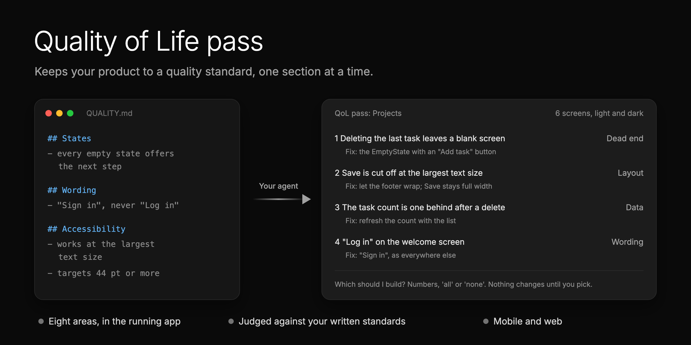

<p align="center">
  
</p>

# Quality of Life (QoL) pass

Quality of Life (QoL) means the small things that make an app easy and pleasant to use.

**Keep your product to a quality standard, one section at a time.** It checks your running app for dead ends, wrong
data, unclear wording, missing empty and error states, layout at the largest text size, motion and accessibility.
You get one list of fixes, and it builds the ones you pick.

Code review catches bugs, not a blank screen after you delete the last item, a button that says "OK", or a label cut
off at the largest text size. This does.

## No standard yet? It writes one

Most teams have no written quality standard, so every review is one person's taste. On the first run it looks for
yours: design docs, an accessibility guide, a copy guide. If there is none, it writes a `QUALITY.md` from what your
code already does, plus defaults for the gaps, marked so you can tell them apart. You approve it, and every pass
checks against it.

## Install

```bash
npx skills add matthewzammit/skills --skill qol-pass
```

It works in Claude Code, Cursor, Codex and other agents. It asks where to install: this project only, or global
(every project on your computer). Run it again to update.

Or as a Claude Code plugin, which installs all the skills in this repo:

```
/plugin marketplace add matthewzammit/skills
/plugin install matthewzammit-skills@matthewzammit
```

## Run it

| You type | When | What happens |
|---|---|---|
| `/qol-pass setup` | Once per repo | Finds or drafts your quality bar, works out how to start the app, asks where records go and how you file tickets. |
| `/qol-pass <section>` | Any time | Passes over that section: "settings", "checkout", "the onboarding flow". |
| `/qol-pass next` | Any time | Suggests the next section nobody has passed yet, the most used first. |

When installed as a Claude Code plugin, the command is `/matthewzammit-skills:qol-pass`. It also starts when you ask
for a polish pass, a UX review of a screen, or a check before a release.

## What it checks

In the running app (a simulator or emulator for mobile, a browser for web), on every screen of the section, in
every theme:

1. **Behaviour:** what each tap or click does, where Back goes, double taps, a slow network.
2. **Dead ends:** a state with no way out or no next step.
3. **Wrong or stale data:** a count, date or label that does not match what you just did.
4. **Wording:** unclear, inconsistent with the same thing elsewhere, or raw backend text.
5. **Empty, loading and error states:** each one exists and helps.
6. **Layout edge cases:** the largest text size, a small screen, long names, many rows; on the web, narrow and wide
   windows and 200% zoom.
7. **Motion and feedback:** press feedback, transitions, Reduce Motion respected.
8. **Accessibility:** screen reader names, tap target sizes, contrast, keyboard use on the web.

## What you get

One numbered list, the most painful first. Each finding says where it is, why it matters (the line of your bar it
breaks), the fix, and 2 or 3 options with a pick where there is a real choice. A made-up example:

```
1. Dead end: after deleting the last task, the list is blank with no way to add one
   Where: Projects, open a project, delete its only task
   Why: QUALITY.md, States: "Every empty state says what goes here and offers the next step."
   Fix: the existing EmptyState with "No tasks yet" and an "Add task" button.
2. Layout: at the largest text size, the Save button is cut off on a small phone
3. Wording: "Log in" on the welcome screen, "Sign in" everywhere else

Which should I build? Numbers, 'all' or 'none'.
```

## After you pick

It builds only what you picked, on a new branch, one commit per finding. It checks each fix in the running app on
the same screen as its before shot, then opens one pull request with before and after shots side by side. It never
merges.

## What it needs

- An agent that can drive your app: a simulator or emulator for mobile, a browser for web (Playwright, a browser
  extension, or your agent's own). Without one it reviews from the code and says so at the top of the list.
- Test accounts and test data. It never triggers anything with a real-world effect (a payment, a sent message) to
  test it.

## Credits

Built from the section-by-section quality passes we ran on the [Binderr](https://binderr.com) Wallet app.
