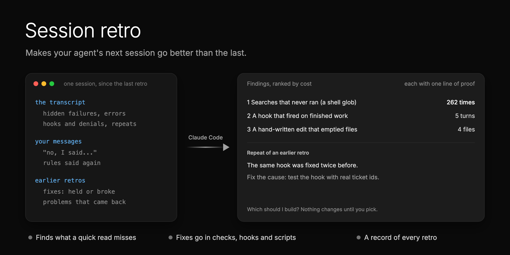

<p align="center">
  
</p>

# Session retro

**Make your agent's next session go better than the last.** It reads what happened in a session, finds the
problems, and fixes them where they start: a check, a hook, a script or a pointer in a doc. Each fix is something
the agent runs into, so it works without anyone remembering it.

It looks for what a quick read misses:

1. **Hidden failures.** A command that failed while its result looked fine. In one session, 262 searches never ran
   because zsh stopped them, and three earlier retros missed it.
2. **Noisy guardrails.** A hook or check that fires when the work is already right. Each false alarm costs a turn.
3. **Repeats.** A problem that came back after an earlier fix. It keeps a record of every retro, so a repeat gets
   fixed at its cause, not patched again.
4. **Your corrections.** Every "no, I said" in the session is a rule the agent did not have.

Every finding comes with its cost (how many times, about how many turns) and one line of proof.

## Install

```bash
npx skills add matthewzammit/skills --skill session-retro
```

It works in agents that run skills. The scan reads Claude Code transcripts, so the full retro is Claude Code only for
now. It asks where to install: this project only, or global (every project on your computer). Run it again to
update.

Or as a Claude Code plugin, which installs all the skills in this repo:

```
/plugin marketplace add matthewzammit/skills
/plugin install matthewzammit-skills@matthewzammit
```

## Run it

| You type | When | What happens |
|---|---|---|
| `/session-retro setup` | Once per repo | Asks where records go and how fixes ship (pull request, plan, ticket). |
| `/session-retro` | At the end of a long session, or when it went badly | Reviews this session since the last retro. Or name another session by its id. |

When installed as a Claude Code plugin, the command is `/matthewzammit-skills:session-retro`.

It is **read-only until you pick**: it lists the findings and changes nothing. When you pick fixes, it builds them
with tests, the way your setup says, and writes a record of the run. It never merges.

## What you get

- Findings ranked by cost, each with proof, a fix, and options with a pick when there is a real choice.
- For each fix from the last retro: held, broke, or not tested yet.
- A fix outside the repo (a line in your shell settings, say) as the exact line for you to add.
- A record per run, so the next retro starts where this one stopped.

## What it needs

- Claude Code, on the machine where the session ran (its transcripts live there).
- Node 18 or newer. The scan script has no dependencies and does not install anything.

## Privacy

Transcripts never leave your machine. The scan masks anything that looks like a token or password before it prints
a command, and the findings quote commands, not your conversations.

## Credits

Based on [Matt Pocock's retro skill](https://github.com/mattpocock/skills) (MIT): the categories and the idea that a
fix belongs in the environment, as a check before a written rule, come from there.

Built from the retros we ran on the [Binderr](https://binderr.com) Wallet app.
