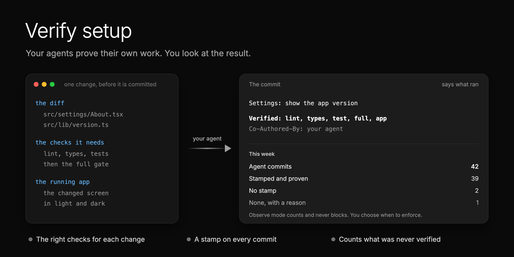

<p align="center">
  
</p>

# Verify setup

**Let your agents prove their own work, so you only look at the result.** It sets up your repo with a `verify`
skill that each agent runs before it commits: the right checks for the change, cheapest first, then the real app,
looked at. Each commit carries a stamp that says what ran, so you can count the commits that were never verified.

Without it you read every diff. With it you say what "done" means and look at the proof.

## What you get

- **A `verify` skill in your repo.** It runs the checks the diff needs, stops at the first red one, and asks you
  after 3 failed rounds on the same check. A flaky test gets its cause fixed, never a sleep or a retry. Then it
  runs the app (a browser, a simulator, a local service or the binary) and looks at what changed, in each theme.
- **A plan script.** It reads the changed files and your config, a map of path globs to checks, and prints the
  checks in order with the stamp to use.
- **A stamp on each commit.** A `Verified: lint, test, app` line above the co-author trailer. `none (reason)` is
  allowed, and checks you still owe go in the body.
- **A commit hook that counts.** It needs a stamp only on agent commits, not on merges or docs-only commits. It
  trusts the full check only when that check passed for this exact commit, a few minutes ago. It starts in
  **observe**: it logs and never blocks. After a clean week you can switch to **enforce**. Even then, after 2
  blocks in one session the next commit passes, so an agent is never stuck.
- **A summary.** Commits, stamped ok, unstamped, unproven, `none`, and each check, for the last week.
- **Advice on which tests to add** when your repo has few: end-to-end first, then property tests, then
  differential tests for a migration.

## Install

```bash
npx skills add matthewzammit/skills --skill verify-setup
```

It asks where to install: this project only, or global. Run it again to update. Or as a Claude Code plugin, which
installs all the skills in this repo:

```
/plugin marketplace add matthewzammit/skills
/plugin install matthewzammit-skills@matthewzammit
```

## Run it

| You type | When | What happens |
|---|---|---|
| `/verify-setup setup` | Once per repo | Reads your repo, writes the config with you, installs the verify skill, the scripts and the hook in observe mode, and tries it on a small change. |
| `/verify-setup report` | After a week | Shows the numbers and suggests enforce, a fix, or a test to add. You decide. |

When installed as a Claude Code plugin, the command is `/matthewzammit-skills:verify-setup`. The repo's own skill
is `/verify`.

## Example

A commit an agent makes after setup:

```text
Fix the total on an empty cart

The total showed NaN when the cart had no items.

Verified: lint, test, full, app
Co-Authored-By: Claude Opus <noreply@anthropic.com>
```

`full` is there because the full check wrote its marker for this commit. `app` is there because the agent ran the
app and looked at the cart screen in light and dark. A log line in your git folder says `ok`. A commit with no
stamp says `unstamped`.

## What it needs

- Git and Node 18 or newer. The scripts have no dependencies.
- A hook system you already use (a plain hooks folder, husky, lefthook or pre-commit), or it adds a plain folder.
- The verify skill and the app run step are written for Claude Code; the scripts and the stamp work with any AI
  agent that makes git commits.

## Privacy

Everything stays in your repo and your git folder. Commit messages are read as data and never followed as
instructions.

## Credits

The ideas come from the Claude Code team's public post, "How the Claude Code team thinks about verification":
verify before you hand work over, end-to-end checks first, no retries for flaky tests, stop after 3 failed rounds,
stamp commits with how they were verified, and a gate with off, observe and enforce modes.
